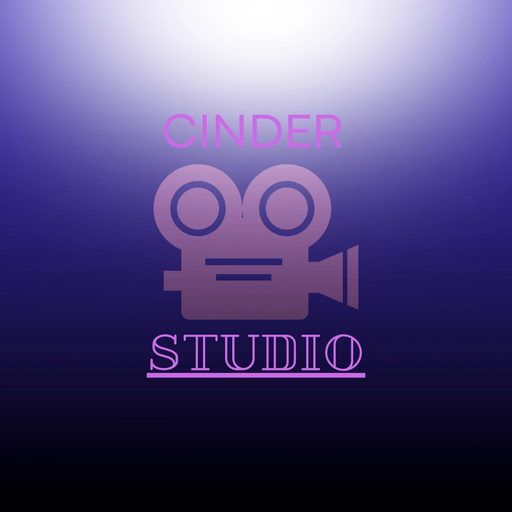
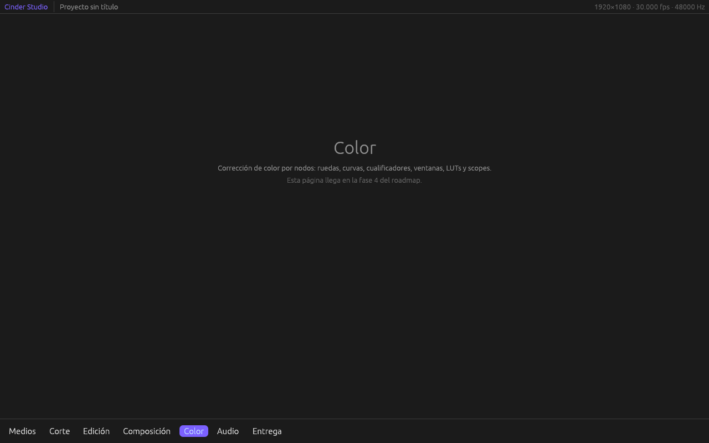

# Cinder Studio

**Página del proyecto:** [staticforge.me](https://staticforge.me/#proyectos)

Editor de vídeo open source (Static Forge) que replica el flujo de trabajo de
DaVinci Resolve — edición, color, composición nodal, audio y entrega en un solo
programa — con código 100% propio, reimplementación clean-room, escrito en
**Rust** y con todo el procesado de imagen en GPU.

Sustituye a CoalMix Studio (DAW, cancelado el 2026-11-10).

**Antes de tocar nada:** lee [`AGENTS.md`](AGENTS.md) (reglas clean-room, no
negociables).

Estado (2026-11-10): Fase 1 en curso. Ya hay ventana (egui sobre wgpu) con las siete
páginas y su barra inferior, y el modelo de proyecto con deshacer/rehacer y guardado en
`.cinder`. Todavía no abre ni reproduce vídeo. Qué se probó, en [`CHANGELOG.md`](CHANGELOG.md).



## Compilar

```
cargo run -p cinder                 # abre Cinder Studio
cargo test --workspace              # tests
cargo clippy --workspace --all-targets -- -D warnings
```

Hace falta Rust estable (1.85 o más nuevo) y una tarjeta con Vulkan, DirectX 12 o Metal.
En Linux, además, las librerías de ejecución de X11 o Wayland que trae cualquier escritorio.

## Documentación

| Documento | Qué cuenta |
|---|---|
| [`AGENTS.md`](AGENTS.md) | Reglas clean-room, qué se replica y qué se mejora, stack, calidad y licencia |
| [`docs/PAGINAS.md`](docs/PAGINAS.md) | Las siete páginas de trabajo y qué hace cada una |
| [`docs/ARQUITECTURA.md`](docs/ARQUITECTURA.md) | Hilos, pipeline de imagen, color, audio y formato de proyecto |
| [`docs/ROADMAP.md`](docs/ROADMAP.md) | Fases, del primer clip reproducido a la composición nodal |
| [`ASSETS.md`](ASSETS.md) | Registro de assets externos y su licencia |
| [`CHANGELOG.md`](CHANGELOG.md) | Qué ha cambiado y qué se ha probado |

## Las siete páginas

`Medios` · `Corte` · `Edición` · `Composición` · `Color` · `Audio` · `Entrega`

El mismo orden y la misma idea que en Resolve: el proyecto avanza de izquierda a
derecha por la barra inferior, y cada página es una herramienta completa sobre la
misma línea de tiempo. Detalle en [`docs/PAGINAS.md`](docs/PAGINAS.md).

## Estructura

Hoy existen `crates/cinder-core` y `apps/cinder`; el resto de crates se crea cuando su fase
empieza.

```
crates/
  cinder-core/      Modelo de proyecto, línea de tiempo, deshacer/rehacer, formato .cinder
  cinder-media/     Decodificación y codificación (FFmpeg), proxies, caché de fotogramas
  cinder-gpu/       wgpu: dispositivo, texturas y pipeline de imagen en coma flotante
  cinder-color/     Grafo de nodos de color, ruedas, curvas, cualificadores, LUTs
  cinder-comp/      Composición nodal
  cinder-audio/     Motor de audio multipista, buses y plugins CLAP
  cinder-render/    Cola de render y exportación
  cinder-interop/   OpenTimelineIO, FCPXML y EDL
  cinder-ui/        Interfaz (egui) y las siete páginas
apps/cinder/        Ejecutable
tests/oracle/       Referencias exportadas desde Resolve para comparar resultados
assets/             Iconos, LUTs y presets propios
```

## MVP

Abrir clips, montarlos en una línea de tiempo multipista con los recortes básicos
y exportar a H.264/H.265, con audio sincronizado. Fases 1–3 de
[`docs/ROADMAP.md`](docs/ROADMAP.md).

## Licencia

Dual **MIT OR Apache-2.0** (ver `LICENSE-MIT` y `LICENSE-APACHE`). FFmpeg se enlaza
dinámicamente en su compilación LGPL. Detalle en `AGENTS.md` §7.
