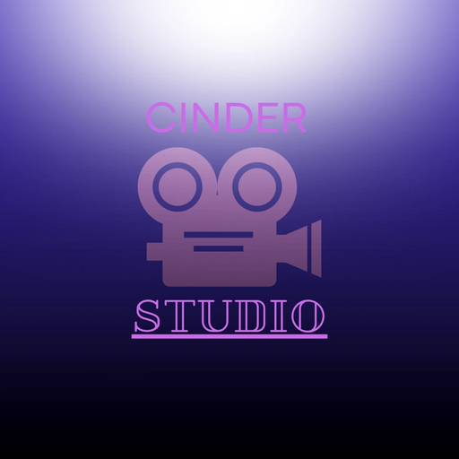
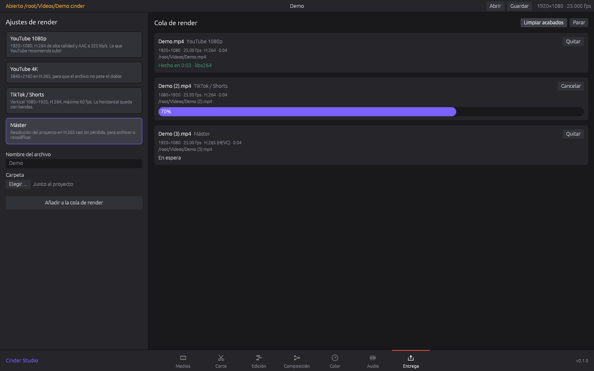
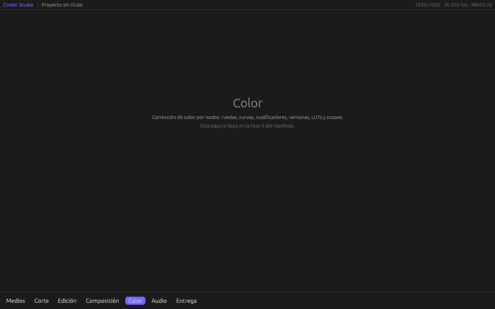

# Cinder Studio

**Página del proyecto:** [staticforge.me/cinder](https://staticforge.me/cinder/)

Editor de vídeo open source (Static Forge) que replica el flujo de trabajo de
DaVinci Resolve — edición, color, composición nodal, audio y entrega en un solo
programa — con código 100% propio, reimplementación clean-room, escrito en
**Rust** y con todo el procesado de imagen en GPU.

Sustituye a CoalMix Studio (DAW, cancelado el 2026-11-10).

**Antes de tocar nada:** lee [`DESARROLLO.md`](DESARROLLO.md) (reglas clean-room, no
negociables).

Estado (2026-11-19): MVP completo (fases 1–3). Abre clips, los monta en una línea de tiempo
multipista con los recortes de Resolve, reproduce el programa con su sonido y lo exporta a
H.264 o H.265 desde la página Entrega, con presets para YouTube, TikTok y máster y una cola de
render. Qué se probó, en [`CHANGELOG.md`](CHANGELOG.md).





## Compilar

```
cargo run -p cinder                 # abre Cinder Studio
cargo test --workspace              # tests
cargo clippy --workspace --all-targets -- -D warnings
```

Hace falta Rust estable (1.85 o más nuevo), una tarjeta con Vulkan, DirectX 12 o Metal, y
las librerías de FFmpeg (4.4 o más nuevo) más clang, que usan los bindings de FFmpeg.

- **Arch:** `sudo pacman -S ffmpeg clang`
- **Debian / Ubuntu:** `sudo apt install clang pkg-config libasound2-dev libavcodec-dev
  libavformat-dev libavutil-dev libavdevice-dev libavfilter-dev libswscale-dev libswresample-dev`
- **Windows:** LLVM (`winget install LLVM.LLVM`) y una compilación **LGPL compartida** de
  FFmpeg, por ejemplo `ffmpeg-n9.0-…-win64-lgpl-shared-9.0.zip` de
  [BtbN/FFmpeg-Builds](https://github.com/BtbN/FFmpeg-Builds/releases). Descomprimirla y, en
  PowerShell:

  ```
  $env:FFMPEG_DIR = "C:\ruta\a\ffmpeg-…-lgpl-shared-9.0"
  $env:LIBCLANG_PATH = "C:\Program Files\LLVM\bin"
  $env:PATH = "$env:FFMPEG_DIR\bin;$env:PATH"   # las DLL, para ejecutar
  cargo run -p cinder
  ```

Para importar clips: arrastrarlos a la ventana, Ctrl+I, o `cargo run -p cinder -- clip.mp4`. Los atajos de montaje están en el [CHANGELOG](CHANGELOG.md).

## Documentación

| Documento | Qué cuenta |
|---|---|
| [`DESARROLLO.md`](DESARROLLO.md) | Reglas clean-room, qué se replica y qué se mejora, stack, calidad y licencia |
| [`docs/PAGINAS.md`](docs/PAGINAS.md) | Las siete páginas de trabajo y qué hace cada una |
| [`docs/ARQUITECTURA.md`](docs/ARQUITECTURA.md) | Hilos, pipeline de imagen, color, audio y formato de proyecto |
| [`docs/ROADMAP.md`](docs/ROADMAP.md) | Fases, del primer clip reproducido a la composición nodal |
| [`ASSETS.md`](ASSETS.md) | Registro de assets externos y su licencia |
| [`CHANGELOG.md`](CHANGELOG.md) | Qué ha cambiado y qué se ha probado |

## Las siete páginas

`Medios` · `Corte` · `Edición` · `Composición` · `Color` · `Audio` · `Entrega`

El mismo orden y la misma idea que en Resolve: el proyecto avanza de izquierda a
derecha por la barra inferior, y cada página es una herramienta completa sobre la
misma línea de tiempo. Detalle en [`docs/PAGINAS.md`](docs/PAGINAS.md).

## Estructura

Hoy existen `crates/cinder-core` y `apps/cinder`; el resto de crates se crea cuando su fase
empieza.

```
crates/
  cinder-core/      Modelo de proyecto, línea de tiempo, deshacer/rehacer, formato .cinder
  cinder-media/     Decodificación y codificación (FFmpeg), proxies, caché de fotogramas
  cinder-gpu/       wgpu: dispositivo, texturas y pipeline de imagen en coma flotante
  cinder-color/     Grafo de nodos de color, ruedas, curvas, cualificadores, LUTs
  cinder-comp/      Composición nodal
  cinder-audio/     Motor de audio multipista, buses y plugins CLAP
  cinder-render/    Cola de render y exportación
  cinder-interop/   OpenTimelineIO, FCPXML y EDL
  cinder-ui/        Interfaz (egui) y las siete páginas
apps/cinder/        Ejecutable
tests/oracle/       Referencias exportadas desde Resolve para comparar resultados
assets/             Iconos, LUTs y presets propios
```

## MVP

Abrir clips, montarlos en una línea de tiempo multipista con los recortes básicos
y exportar a H.264/H.265, con audio sincronizado. Fases 1–3 de
[`docs/ROADMAP.md`](docs/ROADMAP.md).

## Licencia

Dual **MIT OR Apache-2.0** (ver `LICENSE-MIT` y `LICENSE-APACHE`). FFmpeg se enlaza
dinámicamente en su compilación LGPL. Detalle en `DESARROLLO.md` §7.
